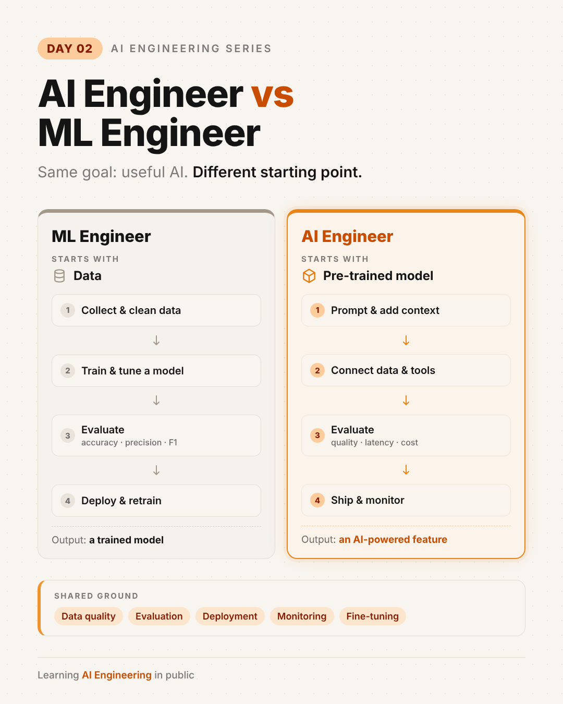

# AI Engineering in Public

One topic a day, from fundamentals to job-ready AI Engineer, following the [roadmap.sh AI Engineer roadmap](https://roadmap.sh/ai-engineer).

Every day includes:

- a plain-language explanation of the topic
- the LinkedIn post and the X post I published
- an infographic (and the prompt used to design it)
- key takeaways, a hands-on mini-project, interview questions, and resources

The full 90-day sequence is in [LEARNING_PLAN.md](LEARNING_PLAN.md). Image rules are in [IMAGE_STYLE_GUIDE.md](IMAGE_STYLE_GUIDE.md), and the daily post format is in [CONTENT_FORMAT.md](CONTENT_FORMAT.md).

## Daily log

| Day | Topic | Section | Level |
|---|---|---|---|
| [01](days/day-01-what-is-an-ai-engineer/) | What is an AI Engineer? | Introduction | Beginner |
| [02](days/day-02-ai-engineer-vs-ml-engineer/) | AI Engineer vs ML Engineer | Introduction | Beginner |

## Latest

<a href="days/day-02-ai-engineer-vs-ml-engineer/"></a>

## Repo layout

```
days/
  day-NN-topic/
    README.md        full notes: explanation, post, takeaways, project, interview Q&A, resources
    image.png        LinkedIn infographic (1080x1350)
    image.html       source used to render the infographic
    image-prompt.md  prompt for AI image tools
    *.py             mini-project code
```
