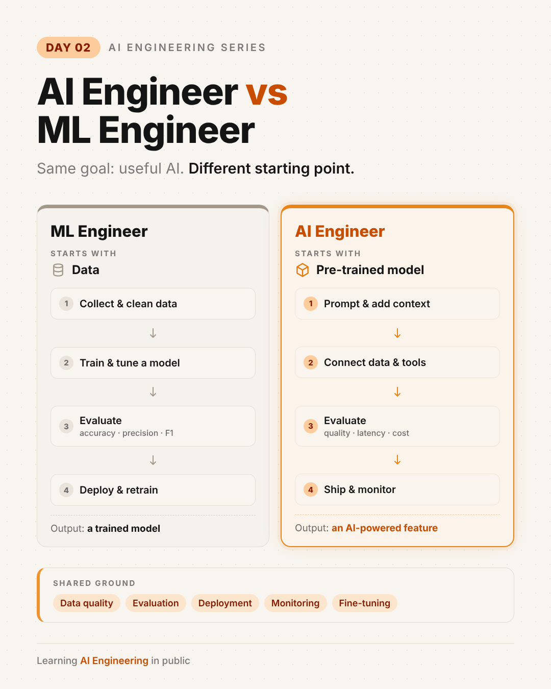

# Day 2: AI Engineer vs ML Engineer



**Roadmap Section:** Introduction → AI Engineer vs ML Engineer
**Difficulty:** Beginner
**Learning Objective:** Explain how the two roles differ in starting point, daily work, skills and success metrics, and see where they overlap.

---

## 1. Understand the Topic

Day 1 said an AI Engineer builds products on top of existing models. Day 2 asks: then who builds the models, and how is that job different?

The roadmap draws the line like this: an **AI Engineer** uses pre-trained models and existing AI tools to improve user experiences, without building models from scratch. **ML Engineers** (and AI researchers) focus more on creating and training models.

The easiest way to see the difference is to look at **where each role starts**:

- An **ML Engineer starts with data.** They collect and clean it, engineer features, train a model, tune it, evaluate it, and run the pipelines that retrain and serve it. The thing they produce is a *trained model*.
- An **AI Engineer starts with a model that already exists.** They write instructions and supply context, connect data and tools, evaluate outputs, and wrap it all in software. The thing they produce is an *AI-powered feature or product*.

| | ML Engineer | AI Engineer |
|---|---|---|
| Starts with | Data | A pre-trained model |
| Main work | Features, training, tuning, training & serving pipelines | Prompts, context/RAG, tools, integration, evals |
| Produces | A trained model | A product feature built on a model |
| Typical metrics | Accuracy, precision/recall, F1, loss | Task success, answer quality, groundedness, latency, cost per request |
| Core skills | Statistics, ML algorithms, PyTorch / scikit-learn, MLOps | Software engineering, APIs, prompting, vector DBs, evaluation |
| Iteration loop | Change data or model → retrain (hours to weeks) | Change prompt or context → re-run evals (minutes) |

**Where they overlap.** Both care about data quality, evaluation, deployment and monitoring. Fine-tuning sits right on the border: an AI Engineer may fine-tune a pre-trained model, which borrows ML-engineering skills. In practice job titles vary a lot between companies, so treat this as a spectrum, not two boxes.

**Which approach fits when?**
- Plenty of labeled data, a narrow and stable task, strict latency/cost limits, or a need for full control → training a model (ML engineering) is often a good fit.
- Little or no labeled data, language-heavy or open-ended tasks, or a need to ship fast → building on a pre-trained model (AI engineering) is often the faster path.

---

## 2. LinkedIn Post

```text
Same two letters in the title. Very different first step.

An ML Engineer opens a dataset.
An AI Engineer opens an API.

Day 2 of learning AI Engineering in public: AI Engineer vs ML Engineer.

Yesterday I wrote that AI Engineers build products on top of existing models. So who builds the models, and how is that job different?

The simplest way I've found to see it: look at where each role starts.

ML Engineer → starts with DATA
Collect and clean data → engineer features → train → tune → evaluate → deploy and retrain.
Output: a trained model.

AI Engineer → starts with a PRE-TRAINED MODEL
Write instructions → add context and data → connect tools → evaluate → ship.
Output: a product feature built on that model.

I tried both on the same tiny problem: classifying product reviews as positive or negative.

The ML way: I trained a small scikit-learn model on 16 labeled reviews. On 6 new reviews it got 2 right. Not because the method is bad, but because 16 examples is nowhere near enough data. ML engineering lives and dies on data.

The AI engineering way: no training at all. One instruction to a pre-trained LLM: "Answer with one word: positive or negative." The model already learned a lot about language before I ever touched it.

That's the trade-off in one experiment:
• Training your own model gives you control, low cost per prediction, and a model built for your exact task, but it needs data and time.
• Building on a pre-trained model gets you started fast with little data, but you pay per request and need guardrails and evals around it.

How the work differs day to day:
→ Metrics: accuracy, precision, recall vs. answer quality, groundedness, latency, cost per request
→ Iteration: retrain (hours to weeks) vs. edit a prompt and re-run evals (minutes)
→ Skills: statistics, ML algorithms, MLOps vs. software engineering, APIs, prompting, evaluation

And the overlap is real: both roles care about data quality, evaluation, deployment, and monitoring. Fine-tuning sits right on the border. Titles also vary a lot between companies, so think of it as a spectrum.

My takeaways from Day 2:
1. ML engineers build the model. AI engineers build with the model.
2. The real difference is the starting point: data vs. a pre-trained model.
3. Knowing ML basics still makes you a better AI engineer, especially for evaluation.

Code for both approaches is on GitHub (link in the comments). Run it and compare the results yourself.

Which side do you lean toward today, and what pulled you there?

#AIEngineering #MachineLearning #MLEngineering #LLM #LearningInPublic #GenerativeAI #CareerInTech
```

---

## 3. X (Twitter) Post

Single post, 280/280 characters.

```text
An ML Engineer opens a dataset. An AI Engineer opens an API.

I classified reviews both ways. A model trained on 16 examples got 2 of 6 right. A pre-trained LLM needed zero training.

ML engineers build the model. AI engineers build with it.

Day 2 #AIEngineering #MachineLearning
```

---

## 4. Image Generation Prompt

See [`image-prompt.md`](image-prompt.md). A rendered version is included as [`image.png`](image.png).

---

## 5. Key Takeaways

1. **Different starting points:** ML Engineers start from data and produce trained models; AI Engineers start from pre-trained models and produce product features.
2. **Different loops and metrics:** retraining and classic ML metrics vs. prompt/context iteration with evals, latency and cost per request.
3. **Real overlap:** data quality, evaluation, deployment, monitoring and fine-tuning are shared ground, and job titles vary between companies.

---

## 6. Practical Implementation

**Mini-project: one problem, two approaches** ([`two_approaches.py`](two_approaches.py))

Classify short product reviews as positive or negative, two ways:

1. **ML engineer way:** train a TF-IDF + logistic regression model with scikit-learn on 16 labeled reviews, then test it on 6 unseen ones.
2. **AI engineer way:** send each test review to a pre-trained LLM with a one-line instruction. No training.

```bash
pip install scikit-learn openai
python two_approaches.py                          # ML part only
OPENAI_API_KEY=sk-... python two_approaches.py    # both parts
```

In my run, the trained model got **2 of 6** right (33%). The test reviews use words it never saw during training, and 16 examples is far too little data. Run the LLM part and compare.

Then try:
- Add 30 to 50 more labeled reviews to `TRAIN` and watch the ML accuracy change.
- Write a tricky review ("I wanted to hate it, but I can't") and see how each approach handles it.
- Think about cost: the trained model runs locally for free; the LLM charges per request.

---

## 7. Interview Preparation

**Q1. What's the main difference between an AI Engineer and an ML Engineer?**
The starting point and the output. An ML Engineer starts with data and produces a trained model: data preparation, feature engineering, training, tuning, and the pipelines to retrain and serve it. An AI Engineer starts with an existing pre-trained model and produces a product feature: prompts, context and retrieval, tool integration, evaluation, and deployment. The roles overlap on evaluation, deployment, monitoring and sometimes fine-tuning.

**Q2. When would you train your own model instead of using a pre-trained LLM?**
When you have plenty of good labeled data for a narrow, stable task, and you need very low latency, low cost per prediction, full control over the model, or must run without an external API (for example on-device or for strict data rules). A small trained classifier can be cheaper and faster than an LLM at high volume. When labeled data is scarce, the task is open-ended or language-heavy, or speed to market matters most, building on a pre-trained model is usually the better starting point. A common pattern is to start with an LLM and train a smaller model later once you have collected enough data.

**Q3. How does evaluation differ between the two roles?**
ML engineers usually have a labeled test set with one correct answer per example, so they use metrics like accuracy, precision, recall, F1 or loss. AI engineers often deal with open-ended outputs (summaries, answers, generated text) where many answers can be acceptable, so they combine automated checks (format, exact match where possible), model-based grading, human review, and product metrics like latency, cost and user feedback. Both need a fixed evaluation set so changes can be compared fairly.

---

## 8. Learning Resources

- [roadmap.sh: AI Engineer Roadmap](https://roadmap.sh/ai-engineer)
- [What does an AI Engineer do? (Codecademy)](https://www.codecademy.com/resources/blog/what-does-an-ai-engineer-do/)
- [What is a Machine Learning Engineer? (Coursera)](https://www.coursera.org/articles/what-is-machine-learning-engineer)
- [Google Machine Learning Crash Course](https://developers.google.com/machine-learning/crash-course): free intro to classic ML concepts.
- [scikit-learn: Working with text data](https://scikit-learn.org/stable/tutorial/text_analytics/working_with_text_data.html): the approach used in the ML half of the mini-project.
- [AI Engineering by Chip Huyen (O'Reilly)](https://www.oreilly.com/library/view/ai-engineering/9781098166298/): chapter 1 compares AI engineering with ML engineering.
