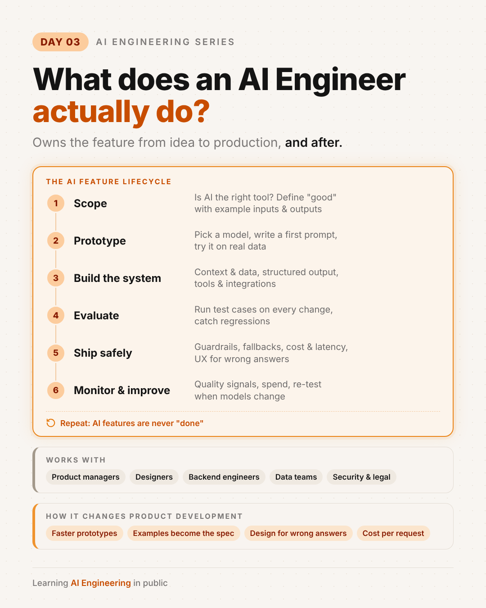

# Day 3: Roles, Responsibilities & Impact on Product Development



**Roadmap Section:** Introduction → Roles and Responsibilities; Impact on Product Development
**Difficulty:** Beginner
**Learning Objective:** Describe what an AI Engineer does across the lifecycle of an AI feature, who they work with, and how AI changes the way products are built.

---

## 1. Understand the Topic

Day 1 defined the AI Engineer. Day 2 compared the role with ML engineering. Day 3 covers **what the job looks like day to day**.

The roadmap describes AI Engineers as people who design, develop and deploy AI systems that solve real problems. They integrate AI into existing software, test and optimize it, scale it for production, monitor it, troubleshoot it, and work with data scientists, developers and other stakeholders so the work matches business goals and stays reliable, efficient and ethical.

The easiest way to see these responsibilities is to follow **one feature through its lifecycle**:

| Stage | What the AI Engineer does |
|---|---|
| 1. Scope | Decide whether AI is the right tool, define what "good" looks like, collect example inputs and expected outputs |
| 2. Prototype | Pick a model, write a first prompt, try it on real examples |
| 3. Build | Add context and data, get structured output, connect tools and the rest of the app |
| 4. Evaluate | Run test cases on every change, measure quality, catch regressions |
| 5. Ship | Add guardrails, fallbacks and timeouts, design for wrong answers, control cost and latency |
| 6. Monitor & improve | Track quality signals, latency and spend, re-test when models change |

Stage 6 loops back to stage 1: AI features are never "done", because user behavior, data and the models themselves keep changing.

**Who they work with:** product managers (problem and success metric), designers (how the interface handles uncertain answers), backend engineers (APIs, data, integrations), data teams, and security and legal (what data can go to which model).

**Impact on product development.** The roadmap notes that AI engineering helps teams automate tasks, build more personalized products, move faster and improve user experiences. In practice, it changes the process itself:
- **Faster prototypes:** a working demo can come together quickly, so ideas get tested earlier.
- **Examples become part of the spec:** "good" is defined by test cases, not just written requirements.
- **Design for wrong answers:** the interface has to handle mistakes (show sources, let users edit, ask for confirmation).
- **A cost per request:** every model call costs money, so usage and pricing matter from the start.
- **Ongoing evaluation:** quality has to be re-checked whenever the prompt, data or model changes.

---

## 2. LinkedIn Post

```text
"Just add AI to it."

One sentence in a product meeting.
Six different jobs for the AI engineer who has to ship it.

Day 3 of learning AI Engineering in public: what does an AI engineer actually do?

Let's follow one feature from idea to production: "Turn meeting transcripts into action items."

1. Scope it
Is AI even the right tool? What does "good" look like? Who owns a task if two people discussed it? This becomes a set of example inputs with expected outputs, before any code.

2. Prototype
Pick a model, write a first prompt, try it on real transcripts. A rough version can exist in a day or two.

3. Build the system
Get structured output (owner, task) the app can store. Add context like the attendee list. Connect it to the task tracker.

4. Evaluate
Run those example cases on every change. Does it miss tasks? Does it invent people who weren't in the meeting?

5. Ship safely
Show which line of the transcript each item came from, let users edit before saving, add timeouts and fallbacks, check the cost per meeting.

6. Monitor and improve
Track how often users edit the results (a great quality signal), watch latency and spend, and re-test when the model provider releases a new version.

Notice how little of this is "call the model".

The role is also very cross-functional:
→ Product managers: which problem, and what success means
→ Designers: how the UI handles answers that might be wrong
→ Backend engineers: APIs, data, integrations
→ Security and legal: what data can go to which model

And it changes how products get built:
• Prototypes come faster, so ideas get tested earlier
• Example inputs with expected outputs become part of the spec
• Designs have to plan for wrong answers, not just happy paths
• Every request has a cost, so usage and pricing matter from day one

My takeaways from Day 3:
1. An AI engineer owns the whole lifecycle, not just the prompt.
2. Evaluation starts before the first line of code.
3. Shipping is the middle of the job, not the end.

On GitHub: a one-page feature brief and a small eval harness for this exact feature (link in the comments).

What's an AI feature you've used that handled "the model might be wrong" really well, or really badly?

#AIEngineering #ProductDevelopment #LLM #LearningInPublic #GenerativeAI #SoftwareEngineering
```

---

## 3. X (Twitter) Post

Single post, 271/280 characters.

```text
"Just add AI to it" is one sentence in a product meeting.

For the AI engineer, it is six jobs: scope it, prototype, build the system, evaluate, ship safely, monitor.

Calling the model is the smallest part.

Day 3 of learning AI Engineering in public #AIEngineering #LLM
```

---

## 4. Image Generation Prompt

See [`image-prompt.md`](image-prompt.md). A rendered version is included as [`image.png`](image.png).

---

## 5. Key Takeaways

1. **The AI Engineer owns the whole lifecycle:** scope, prototype, build, evaluate, ship, monitor. Calling the model is a small part of it.
2. **It's a cross-functional role:** product, design, backend, data, and security and legal all shape an AI feature.
3. **AI changes product development itself:** faster prototypes, test cases as part of the spec, designing for wrong answers, cost per request, and evaluation that never stops.

---

## 6. Practical Implementation

**Mini-project: brief + eval set for an "action item extractor"**

Two artifacts an AI engineer creates before and during a build:

1. [`feature_brief.md`](feature_brief.md): a one-page brief covering the problem, why AI fits, what "good" means, the system design, the UX for wrong answers, cost, post-launch plans and who's involved. Reuse it as a template.
2. [`run_evals.py`](run_evals.py) + [`eval_cases.json`](eval_cases.json): four test cases checked by simple, deterministic rules:
   - the right number of action items
   - every expected owner is found
   - no owner who wasn't in the meeting

```bash
pip install openai
export OPENAI_API_KEY="sk-..."
python run_evals.py
```

You'll get PASS/FAIL per case and a final score like `3/4 cases passed`. I tested the checking logic offline with planted bad answers: it flagged a missing owner and a made-up name ("Vendor").

Then try:
- Add a case of your own (a task with a due date, or someone declining a task).
- Change one line of the prompt and re-run. Did anything break? That's a regression test.

---

## 7. Interview Preparation

**Q1. Walk me through the lifecycle of shipping an AI feature.**
1. **Scope:** confirm AI is the right tool, define success, and collect example inputs with expected outputs.
2. **Prototype:** pick a model and test a first prompt on real data.
3. **Build:** add context and retrieval, structured output, tool and API integrations, and error handling.
4. **Evaluate:** run a fixed eval set on every change.
5. **Ship:** add guardrails, fallbacks, cost and latency limits, and a UX that handles mistakes.
6. **Monitor:** track quality signals, latency and spend in production, and re-evaluate when prompts, data or model versions change. Then go back to step 1.

**Q2. How do you decide whether a feature should use an LLM at all?**
Use an LLM when the input is messy natural language or the task is open-ended, and when rules or simple code would break on real-world variety. Avoid it, or keep it narrow, when a deterministic solution works (math, lookups, fixed business rules), when errors are very costly and can't be caught, or when latency and cost limits rule it out. A good check: can you define "correct" well enough to evaluate it? If not, scope the problem further first.

**Q3. How do you handle a model being wrong in a user-facing product?**
Assume it will be wrong sometimes and design for it:
- Validate outputs, for example with a schema and allowed values, and fall back safely when validation fails.
- Ground answers in provided data and show sources so users can verify.
- Let users review, edit or confirm before anything important happens.
- Log failures and user corrections, and add them to the eval set so the same mistake gets caught next time.

---

## 8. Learning Resources

- [roadmap.sh: AI Engineer Roadmap](https://roadmap.sh/ai-engineer)
- [AI Engineer Job Description (Workable)](https://resources.workable.com/ai-engineer-job-description): typical responsibilities and skills.
- [How To Become an AI Engineer (Indeed)](https://www.indeed.com/career-advice/finding-a-job/ai-engineer): job duties and skills.
- [People + AI Guidebook (Google PAIR)](https://pair.withgoogle.com/guidebook/): designing products around AI, including handling errors and building trust.
- [Guidelines for Human-AI Interaction (Microsoft HAX Toolkit)](https://www.microsoft.com/en-us/haxtoolkit/ai-guidelines/): research-backed UX guidelines for AI features.
- [AI Engineering by Chip Huyen (O'Reilly)](https://www.oreilly.com/library/view/ai-engineering/9781098166298/): covers the end-to-end process of building AI applications.
